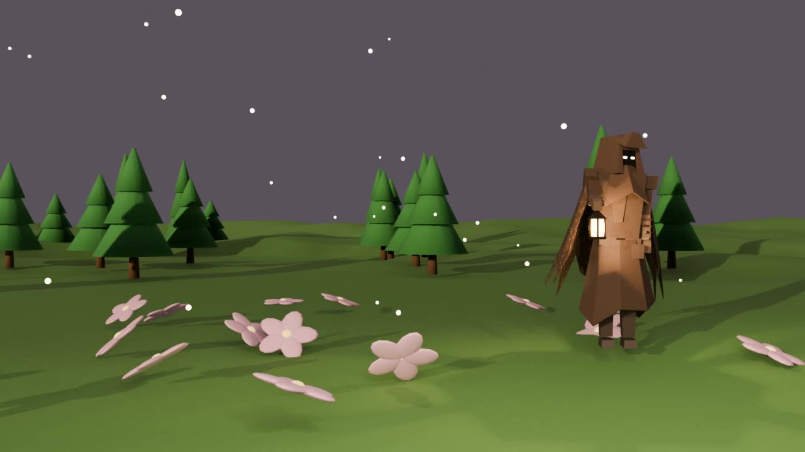
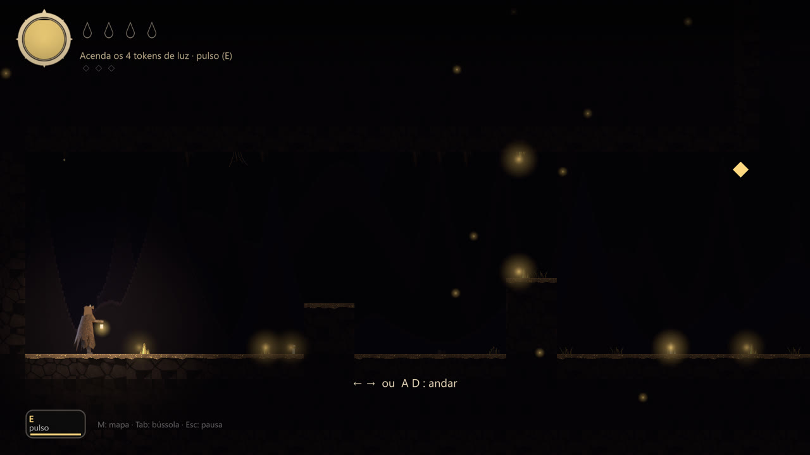
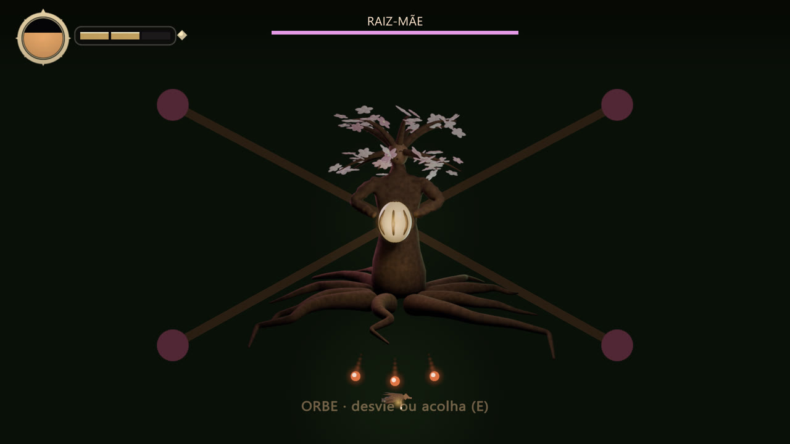
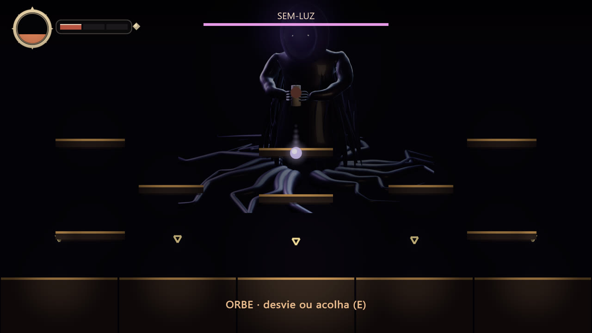
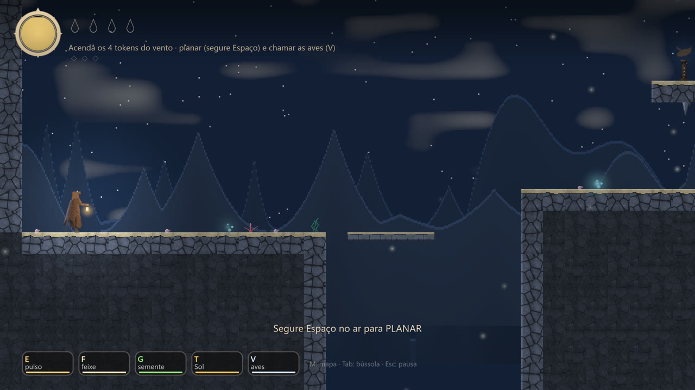

<div align="center">

# ORIGIN · Breath of Light

**Um jogo de plataforma e exploração com chefes que aprendem o seu jeito de jogar.**




*Kairos Interactive*

</div>

---

## Sobre o jogo

Você é o **Artesão**, carregando uma lanterna por sete dias de criação.

Em cada Dia você:
- acende os tokens de luz;
- explora salas ligadas como num metroidvania;
- encontra lembranças escondidas;
- ganha uma habilidade nova.

As habilidades, na ordem: o pulso, o feixe que reflete em espelhos, as sementes que viram videiras, o Sol e a Lua, as aves e o planar.

No fim de cada etapa há um **chefe que aprende**. Ele observa o que você repete e passa a resistir àquilo, então é preciso variar.

| | |
|---|---|
|  |  |
|  |  |

### O que tem nesta versão
- **7 Dias** com mapas para explorar, mais o Santuário.
- **6 chefes** que aprendem: Sem-Luz, Maré Sem Fundo, Raiz-Mãe, Eclipse, Tempestade e Mundo-Mistura. Cada um tem música própria.
- **Missões secundárias** com regras diferentes da campanha: escalada, labirintos, ordem de bulbos, voo, nado.
- **Cutscenes em vídeo** feitas no Blender.
- **Menu animado** que acompanha a história do Artesão.
- **4 temáticas de dificuldade:** Chama, Brasa, Eclipse e Abismo.
- **6 idiomas:** português, inglês, francês, italiano, russo e chinês.

## Como jogar

1. Baixe o `ORIGIN_Alpha_1.0.0.zip` em **[Releases](../../releases)**.
2. Descompacte a pasta inteira e abra o `ORIGIN.exe`.
3. Se o Windows mostrar "O Windows protegeu o computador", clique em **Mais informações** e depois em **Executar assim mesmo**. O jogo ainda não tem assinatura digital.

**Requisitos:** Windows 10 ou 11 (64 bits) e placa de vídeo com DirectX 11.

### Controles

| Ação | Teclado e mouse | Controle |
|---|---|---|
| Andar | A / D ou setas | analógico |
| Pular (segure para ir mais alto) | Espaço, W ou ↑ | A |
| Pulso de luz | E ou clique esquerdo | X |
| Feixe de luz e mira | F ou clique direito, mouse | RB, analógico direito |
| Semente | G (segure e solte) | LB |
| Sol / Lua | T | Y |
| Aves e planar | V, segure Espaço no ar | B |
| Interagir | Enter | RT |
| Mapa, bússola, pausa | M, Tab, Esc | Select, Start |
| Janela / tela cheia | Alt + Enter | |

## Versões

Este jogo está em **Alpha**. O visual ainda é provisório, e o foco agora é corrigir bugs e ajustar a jogabilidade. Depois vem a **Beta**, com o visual refeito.

O número da versão segue `Maior.Média.Pequena`:
- uma rodada de alterações sobe o número do meio;
- um ajuste pequeno sobe o último;
- uma mudança muito grande sobe o primeiro.

O histórico completo está no **[CHANGELOG](CHANGELOG.md)**.

## Encontrou um problema?

Abra uma [Issue](../../issues) com:
- o que aconteceu;
- em qual Dia, fase ou chefe você estava;
- um print, se possível.

Se o jogo fechar sozinho, anexe o arquivo de log:

```
%USERPROFILE%\AppData\LocalLow\Kairos Interactive\ORIGIN\Player.log
```

---

<div align="center">
<sub>© 2026 Kairos Interactive · Todos os direitos reservados</sub>
</div>
